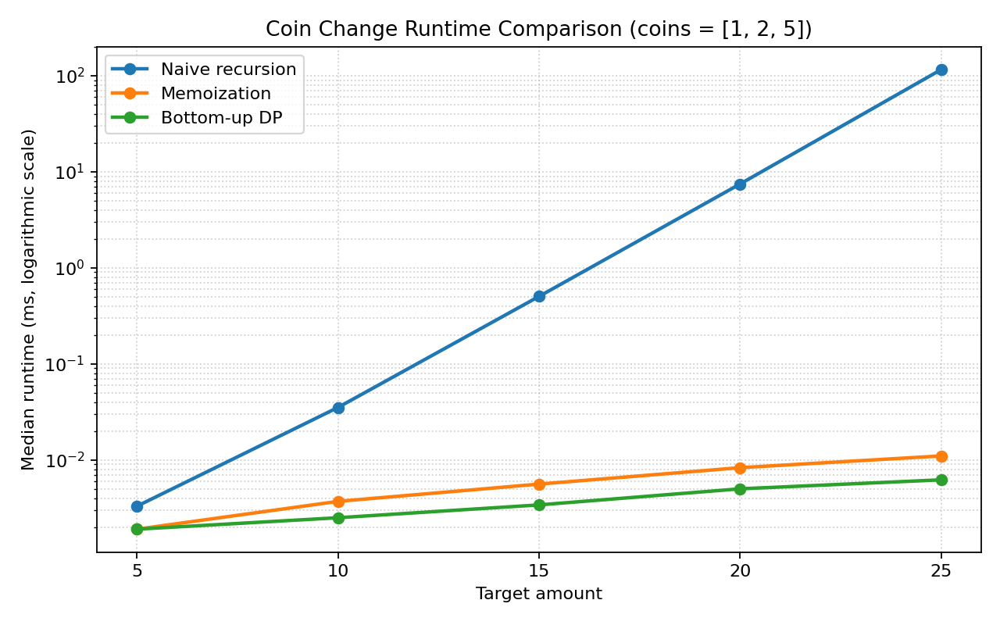

# Empirical Comparison

I tested `coins = [1, 2, 5]` with amounts 5, 10, 15, 20, and 25 on Windows using Python 3.13.14. The table and graph show the median of three runs measured with `perf_counter()`; each memoized run starts with a fresh dictionary. The benchmark script also checks that all three approaches return the same result.

| Amount | Naive recursion | Memoization | Bottom-up DP |
|---:|---:|---:|---:|
| 5 | 0.003 ms | 0.002 ms | 0.002 ms |
| 10 | 0.035 ms | 0.004 ms | 0.003 ms |
| 15 | 0.504 ms | 0.006 ms | 0.003 ms |
| 20 | 7.467 ms | 0.008 ms | 0.005 ms |
| 25 | 115.870 ms | 0.011 ms | 0.006 ms |

Naive recursion became much slower as the amount increased, while memoization and bottom-up DP stayed fast across these tests. For amount 25, naive recursion took about 116 ms, compared with about 0.011 ms for memoization and 0.006 ms for bottom-up DP. The graph uses a logarithmic time axis so all three approaches remain visible.
